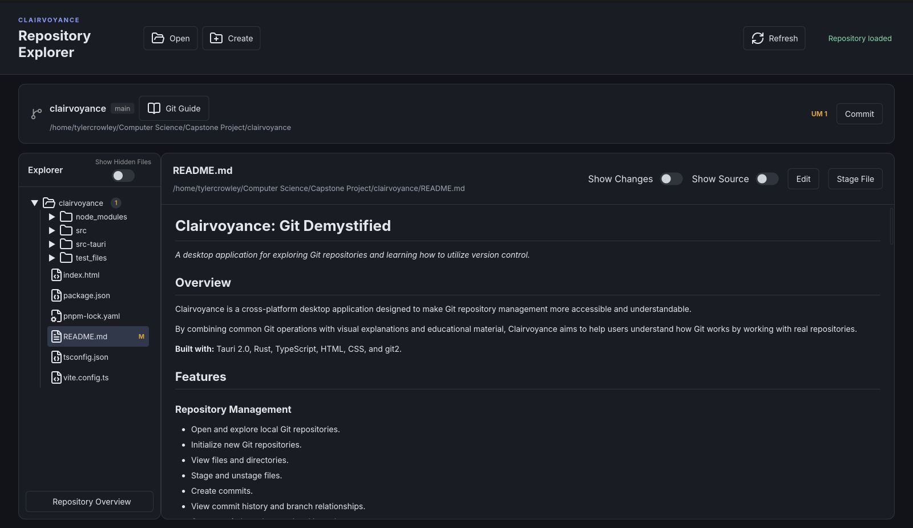
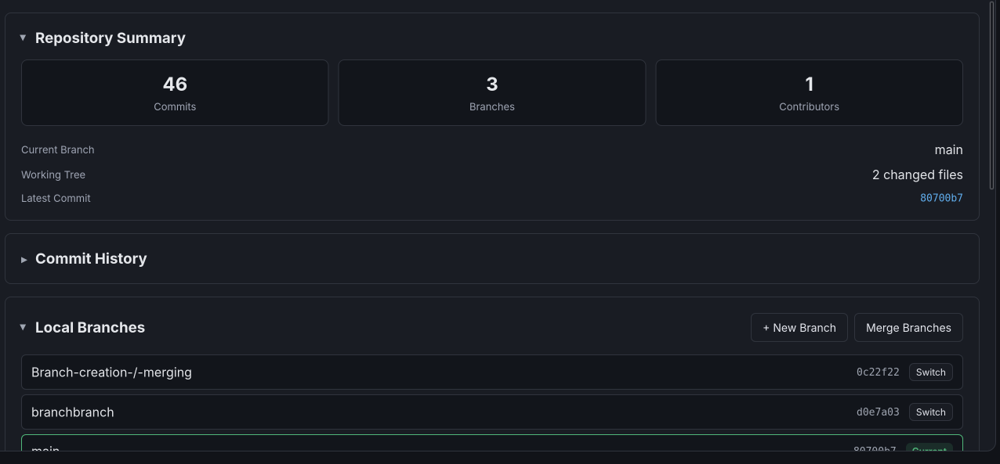
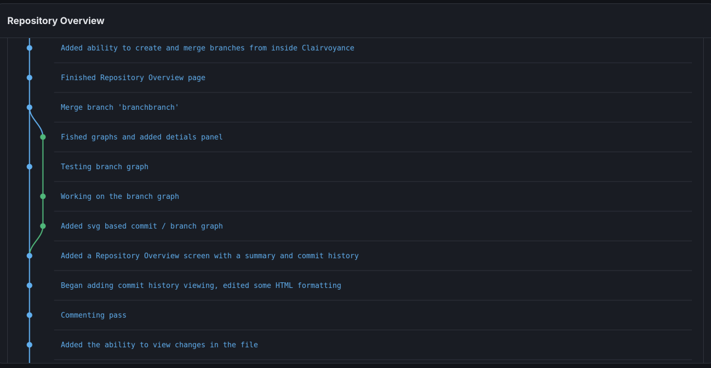
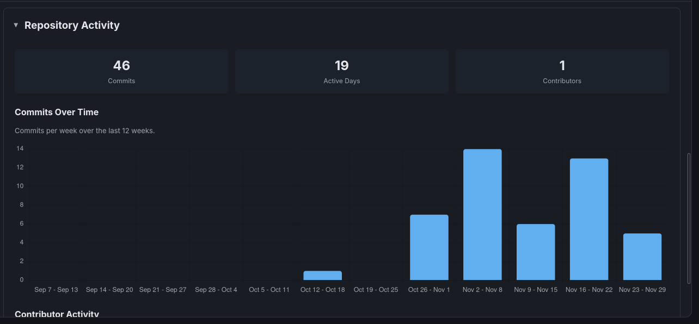
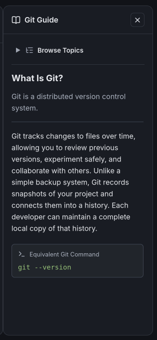

# Clairvoyance: Git Demystified

*A desktop application for exploring Git repositories and learning how to utilize version control.*


## Overview

Clairvoyance is a cross-platform desktop application designed to make Git repository management more accessible and understandable.

By combining common Git operations with visual explanations and educational material, Clairvoyance aims to help users understand how Git works by working with real repositories.

**Built with:** Tauri 2.0, Rust, TypeScript, HTML, CSS, and git2.

## Features

### Repository Management
- Open and explore local Git repositories.
- Initialize new Git repositories.
- View files and directories.
- Stage and unstage files.
- Create commits.
- View commit history and branch relationships.
- Create, switch, and merge local branches.

### File Management and Viewing
- Create, rename, move, and delete files and folders.
- View and edit text files.
- Render Markdown documents.
- Preview images, PDFs, and DOCX documents.

### Repository Visualization
- View a graph of commit and branch history.
- Inspect individual commits and changed files.
- View repository usage statistics.
- Explore contributor activity and commits over time.

### Git Education
- Browse an integrated Git Guide.
- Read explanations of common Git operations.
- View diagrams of Git's working directory, staging area, and repository.
- See equivalent Git commands.

## Screenshots

### File Explorer


### Repository Summary


### Commit History


### Repository Activity


### Git Guide


## Installation

### Supported Platforms

- Linux (all major distros)
- macOS Catalina (10.15) and later
- Windows 10 and above

### Download

1. Visit the project's Releases page.
2. Download the appropriate package for your operating system.
3. Install and launch Clairvoyance.

### Building from Source

**Prerequisites**
- Rust and Cargo
- Node.js and npm
- Tauri 2 platform-specific dependencies

Clone the repository:

```bash
git clone https://github.com/TylerCrowley/clairvoyance
cd <repository-directory>
```

Install dependencies:

```bash
npm install
```

Launch the development application:

```bash
npm run tauri dev
```

Build the production application:

```bash
npm run tauri build
```

## Getting Started

1. Launch Clairvoyance.
2. Select **Open** to choose an existing Git repository, or **Create** to initialize a new one.
3. Explore files and directories using the Explorer sidebar.
4. Select a file to view its contents or Git changes.
5. Stage changes and create commits using the available controls.
6. Open **Repository Overview** to inspect commits, branches, and activity.
7. Open **Git Guide** to explore explanations of Git concepts and operations.

## Architecture

Clairvoyance uses Tauri 2 to connect a TypeScript-based frontend with a Rust backend.

### Frontend

The frontend is responsible for:
- Application layout and user interactions.
- Repository Explorer rendering.
- File previews and editing.
- Commit graph and activity visualizations.
- Educational content.

### Backend

The Rust backend is responsible for:
- Git repository validation and initialization.
- Git operations through the `git2` crate.
- Filesystem access and file management.
- Repository history and status retrieval.
- Path validation and filesystem protections.

Communication between the frontend and backend is handled through Tauri.

## Known Limitations

Clairvoyance is an educational Git management application, developed as a master's capstone project. It focuses on common local repository operations and is not intended to replace a full-featured Git client or integrated development environment.

### Git Functionality

- Remote operations, including cloning, fetching, pulling, and pushing, are not supported.
- Advanced Git operations such as rebasing, cherry-picking, stashing, and tag management are not available.
- Branch management and merging are limited to local branches.
- Merge conflicts cannot be resolved within the application.
- The commit history view displays a maximum of 50 commits.
- Certain operations require a clean working directory.

### File Viewing and Editing

- Text files must use UTF-8 encoding and cannot exceed 2 MiB.
- Supported image, PDF, and DOCX previews are limited to files of 20 MiB or less.
- Images, PDFs, and DOCX documents can be viewed but not edited.
- Other binary file formats are not supported for preview.
- The text editor does not provide advanced IDE features such as syntax highlighting or autocompletion.
- Markdown previews restrict embedded resources and links.

### Other Limitations

- Symbolic-link operations are restricted.
- The activity visualization focuses on the most recent 12 weeks.
- Some Git operations and repository states may require an external Git client.

## Future Development

Potential additions include:
- Remote repository operations.
- Additional Git features.
- More comprehensive educational content.
- Additional format support for viewing and editing.
- Expanded file editing functionality.
- Keyboard shortcuts for editing and navigation.
- Mobile platform compatibility.
- Theme switching supported through json.

## About the Project

Clairvoyance was developed as the capstone project for my Masters of Computer Science at Northern Michigan University.

The project explores Rust and Tauri desktop development while investigating how visual interfaces and integrated explanations can help users understand Git.

## License

Clairvoyance: Git Demystified is free and open-source software licensed under the **GNU General Public License, version 3 or later (GPL-3.0-or-later)**.

You are free to use, modify, and redistribute the software under the terms of this license. Redistributed versions must comply with the GPL, including its source-code availability requirements.

See the [LICENSE](./LICENSE) file for the complete license terms.

Copyright (C) 2026 Tyler Crowley.

## Acknowledgments

Clairvoyance was developed as the capstone of my graduate degree in Computer Science, and represents the culmination of the past five years and work and education. I would like to thank all of the incredible professors I studied under at Northern Michigan University, but in particular my adviosr Dr. Andrew Poe for his guidance and support throughout my entire time at NMU.

I would also like to acknowledge the developers and contributors of the open-source projects that made Clairvoyance possible. In particular, [Rust](https://github.com/rust-lang/rust), [Tauri](https://github.com/tauri-apps/tauri), and [git2-rs](https://github.com/rust-lang/git2-rs) *(based on [libgit2](https://github.com/libgit2/libgit2))* provided the foundation for the application, while libraries such as [Lucide](https://github.com/lucide-icons/lucide), [Chart.js](https://github.com/chartjs/Chart.js), and [PDF.js](https://github.com/mozilla/pdf.js) supported its interface and visualization features.

Finally, I appreciate the documentation and educational resources provided by the broader open-source community, which were invaluable throughout the process of learning Rust and developing Clairvoyance.